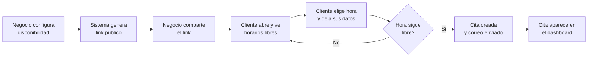
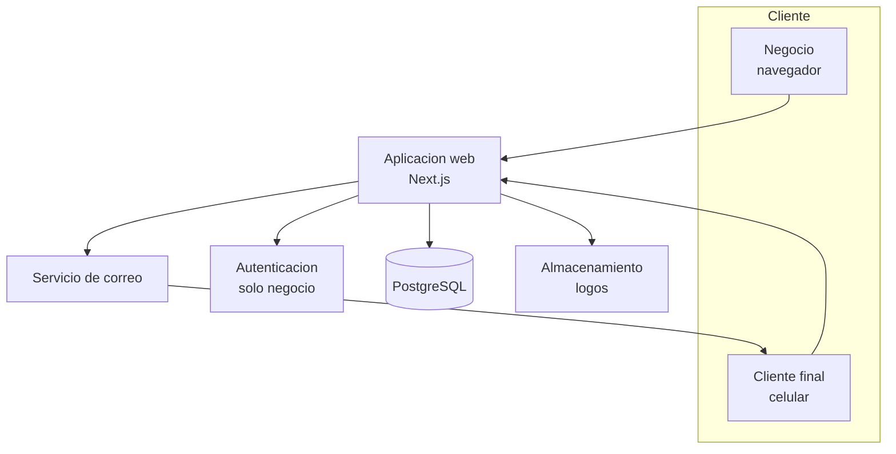
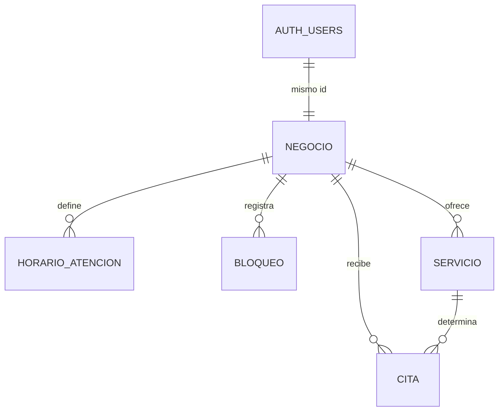

# Cupo: Documento de Visión del Producto


## Identificación

Cupo es una agenda de citas por enlace para negocios de servicio pequeños: el negocio comparte un link, el cliente elige un horario disponible y la cita aparece en el calendario del negocio sin que nadie escriba un mensaje.

| Campo | Dato |
| --- | --- |
| Equipo | Cupo |
| Integrantes | Arturo Lozada González, Jesús Eduardo Alvarado Castañeda |
| Materia | CS13309 Proyecto de Ingeniería de Software, Tecmilenio |
| Entrega | Fase 2, Sprint 0 (Discovery), 26 de septiembre de 2026 |
| Repositorio | [github.com/arthurtoast/CUPO](https://github.com/arthurtoast/CUPO) |

## El problema

El negocio pequeño que agenda citas administra su calendario por WhatsApp, y cada cita cuesta entre tres y seis mensajes de ida y vuelta.

El flujo actual es siempre el mismo. El cliente escribe preguntando si hay espacio. El negocio revisa una libreta, una hoja de Excel o su memoria. Propone un horario. El cliente responde horas después, cuando ese horario ya se lo dieron a alguien más. Vuelven a empezar.

Esto produce cuatro costos concretos:

- **Tiempo del dueño.** En estos negocios quien agenda suele ser la misma persona que da el servicio, así que responder mensajes interrumpe el trabajo cobrable.
- **Doble reserva.** Sin una fuente única de verdad, dos clientes terminan en el mismo horario y alguien se va molesto.
- **Huecos vacíos.** El cliente que no puede asistir no avisa, porque avisar requiere escribir un mensaje y dar explicaciones. El espacio se pierde.
- **Horario fuera de servicio.** Los mensajes que llegan a las 11 de la noche se contestan al día siguiente, y para entonces el cliente ya buscó en otro lado.

El problema no es la falta de software. Existen Calendly, Booksy, Doctoralia y AgendaPro. El problema es que el negocio de una a cinco personas no adopta ninguno: la mensualidad no se justifica contra su volumen, la configuración inicial pide más datos de los que quiere capturar, y el producto está diseñado para un salón o una clínica con recepción, no para una persona que corta cabello y contesta el teléfono al mismo tiempo.

## Usuarios

Cupo tiene dos roles con necesidades opuestas: el negocio quiere control y el cliente final quiere velocidad.

**Rol 1, el negocio (usuario primario).** Dueño, estilista, profesional independiente o recepcionista de un local de una a cinco personas. Es quien se registra, configura sus horarios y paga. Su criterio de éxito es dejar de contestar mensajes para agendar. Su miedo es perder el control del calendario y que se le llene de citas que no puede atender.

**Rol 2, el cliente final (usuario secundario).** No se registra, no instala nada y probablemente entra desde el celular. Llega por un link que el negocio le compartió en WhatsApp, Instagram o su tarjeta. Su criterio de éxito es apartar su lugar en menos de un minuto. Si el flujo le pide crear una cuenta, abandona.

### Los tres segmentos iniciales

El núcleo del producto es el mismo para los tres. Lo que cambia es la duración del servicio y el dato que se captura al reservar.

| Segmento | Ejemplo de usuario | Duración de la cita | Particularidad |
| --- | --- | --- | --- |
| Salud y consultorio | Nutriólogo, psicólogo, dentista de un consultorio | Fija, 30 a 60 min | Necesita saber si es primera vez o seguimiento |
| Belleza y estética | Estética, barbería, manicurista, maquillista | Variable, 30 min a 2 h según servicio | La duración depende del servicio elegido |
| Consultoría y servicios profesionales | Consultor, tutor, asesor, entrenador | Fija, 45 a 60 min | Suele atender en línea, necesita el link de la videollamada |

El denominador común es el que define el producto: una sola persona da el servicio y administra la agenda, el volumen es de cinco a treinta citas por semana, y hoy lo resuelven con WhatsApp más una libreta o un Excel.

## Propuesta de valor y diferenciación

Cupo apuesta a que el negocio de una a cinco personas no necesita menos funciones que Booksy, necesita menos configuración y una página que se sienta suya: estar agendando en diez minutos, con su logo y su color, sin capturar catálogo, sin sucursales y sin tarjeta.

La frase que resume el producto: **comparte un link, deja de contestar mensajes.**

| Competidor | A quién sirve bien | Dónde deja el hueco |
| --- | --- | --- |
| WhatsApp más libreta | Nadie, pero es lo que ya usan | Sin fuente única de verdad, sin horario fuera de servicio, cero costo de cambio |
| Calendly | Profesionales de oficina y equipos remotos | Pensado en reuniones, no en servicios presenciales; en español su adopción local es baja |
| Booksy, AgendaPro | Salones y clínicas con recepción y varios prestadores | Mensualidad y configuración pesadas para un local de dos sillas |
| Doctoralia | Médicos que además quieren captación de pacientes | Vertical cerrada al sector salud, modelo orientado a directorio |

Cuatro decisiones nos separan de todos ellos:

1. **Configuración en diez minutos.** Nombre, horario de atención, duración del servicio y listo. El link queda vivo. Todo lo demás es opcional.
2. **Su marca, no la nuestra.** El negocio sube su logo, elige su color y escribe su descripción desde el dashboard. La página que ve el cliente se siente del negocio, no de Cupo, sin que nadie del equipo tenga que armarla.
3. **El cliente final nunca crea cuenta.** Elige horario, deja nombre, correo y teléfono, y se acabó. Cancelar y reagendar se hace desde un enlace con token único en el correo de confirmación, sin contraseña.
4. **Una sola pantalla de operación.** El negocio abre el dashboard y ve su calendario. No hay módulos, reportes ni catálogos que aprender.

Una advertencia honesta que el equipo asume: la diferenciación aquí es de experiencia y de posicionamiento, no de tecnología. Nada de lo que hace Cupo es técnicamente inalcanzable para un competidor. La apuesta es que el segmento está mal atendido, no que el problema sea difícil.

## Alcance del MVP

El MVP es el ciclo completo de una cita: el negocio publica su disponibilidad, un desconocido reserva desde el link, y ambos quedan notificados. Nada más.

Si eso funciona de punta a punta con un usuario externo, el proyecto está terminado según la definición del curso. Todo lo demás es mejora.

### Dentro del MVP

- Registro e inicio de sesión del negocio con Supabase Auth
- Configuración de horario de atención por día de la semana y duración estándar de la cita
- Bloqueo de fechas y horas específicas (vacaciones, comida, una tarde ocupada)
- Personalización de marca: logo, color de acento, descripción y datos de contacto del negocio
- Página pública de reserva con URL propia por negocio, pintada con la marca de ese negocio
- Cálculo de horarios disponibles a partir del horario configurado menos lo ya reservado
- Formulario de reserva con nombre, correo y teléfono, sin cuenta para el cliente
- Correo de confirmación al cliente y aviso al negocio
- Cancelación por parte del cliente mediante enlace con token único
- Dashboard con vista de calendario y lista de citas próximas
- Cancelación de una cita por parte del negocio

### Fuera del MVP

Cada exclusión tiene una razón, no es olvido:

| Queda fuera | Por qué |
| --- | --- |
| Cobros y pagos en línea | Integrar una pasarela consume un sprint completo y no es el dolor central |
| Notificaciones por WhatsApp | La API de negocio de Meta exige verificación, tarjeta y aprobación con tiempos que no controlamos |
| Varios prestadores por negocio | Multiplica la complejidad del cálculo de disponibilidad; el segmento objetivo es de una persona |
| Catálogo de servicios con precios | La duración variable por servicio es la versión útil de esto y queda como historia de prioridad media |
| Aplicación móvil nativa | La web responsiva cubre el caso; el cliente llega por link, no por tienda de apps |
| Reportes y analítica | Un negocio de treinta citas por semana no necesita tableros |
| Recordatorios automáticos previos a la cita | Requiere tareas programadas; es la primera candidata a entrar si sobra tiempo en el Sprint 3 |

### Criterio de terminado

El producto está listo cuando una persona ajena al equipo, sin instrucciones y desde su propio celular, abre el link, reserva una cita, recibe el correo, y esa cita aparece en el dashboard del negocio.

## Las tres pantallas clave

Las tres pantallas que definen el producto son la configuración de disponibilidad, la página pública de reserva y el dashboard del negocio. Si estas tres funcionan, Cupo funciona.

| # | Pantalla | Quién la usa | Qué resuelve |
| --- | --- | --- | --- |
| 1 | Configuración de disponibilidad y marca | Negocio | Define horario de atención, duración de la cita, bloqueos, y la marca que verá el cliente: logo, color y descripción. Es la única pantalla de configuración del MVP |
| 2 | Página pública de reserva | Cliente final | Muestra días y horarios libres con la marca del negocio, captura los datos y confirma. Debe resolverse en menos de un minuto desde el celular |
| 3 | Dashboard de agenda | Negocio | Calendario con lo reservado, detalle del cliente y cancelación. Es la pantalla que el negocio abre todos los días |

### Flujo principal



El rombo del diagrama es la parte que más cuidado necesita. Entre que el cliente ve la lista de horarios y presiona confirmar pasan segundos en los que otra persona pudo haber tomado ese lugar, así que la validación real ocurre al guardar, contra la base de datos, no al pintar la lista.

## Arquitectura técnica

Cupo es una aplicación web monolítica con base de datos relacional. No hay microservicios, colas ni cachés: el volumen esperado no los justifica y añadirlos costaría sprints sin mejorar el producto.

Durante el Sprint 0 el desarrollo corre en local. La ruta de producción está definida abajo y se ejecuta en el Sprint 1, cuando el curso exige URL pública.

### Componentes



El cliente final nunca toca el módulo de autenticación. Esa es la decisión de arquitectura más importante del proyecto, porque es lo que permite que reservar tome menos de un minuto.

### Stack propuesto

| Capa | Herramienta | Por qué |
| --- | --- | --- |
| Frontend y backend | Next.js con React | Un solo repositorio sirve la página pública y el dashboard, con rutas de API en el mismo proyecto |
| Base de datos | PostgreSQL | Relacional, con restricciones de exclusión sobre rangos de tiempo, que es lo que impide la doble reserva |
| Autenticación | Supabase Auth | Resuelve registro, sesión y recuperación de contraseña sin consumir un sprint |
| Almacenamiento de archivos | Supabase Storage | Guarda el logo de cada negocio y lo sirve por URL pública, sin montar un servidor de archivos |
| Vista de calendario | FullCalendar | Construir un calendario a mano costaría semanas y no aporta nada al problema |
| Correo transaccional | Resend | Capa gratuita suficiente para el volumen del semestre |
| Control de versiones | Git y GitHub Projects | Requisito del curso; el backlog vive como Issues |

### Entorno local, Sprint 0

PostgreSQL en Docker, Next.js en modo desarrollo, y los correos capturados por un servidor SMTP de prueba en lugar de enviarse. Las variables de entorno se documentan en un archivo de ejemplo dentro del repositorio, nunca los valores reales.

### Ruta a producción, Sprint 1

La alternativa que el equipo propone es Vercel más Supabase, ambos con capa gratuita suficiente para el semestre. Vercel se conecta al repositorio y despliega en cada push a la rama principal, lo cual además deja el historial de despliegues como evidencia del proceso. Supabase provee la base de datos PostgreSQL administrada y la autenticación.

La decisión de no desplegar todavía es deliberada: el Sprint 0 es discovery, y desplegar una aplicación sin funcionalidad no aporta evidencia. El compromiso es tener URL pública antes del cierre del Sprint 1, el 24 de octubre, que es cuando el curso la vuelve obligatoria.

## Modelo de datos

Cinco entidades propias cubren el MVP completo, más la tabla `auth.users` que administra Supabase. Dos decisiones de diseño sostienen el modelo. La primera es que el negocio no guarda credenciales: su identificador es el mismo identificador del usuario en Supabase Auth. La segunda es que la cita guarda una copia de los datos del cliente en lugar de apuntar a una cuenta, porque el cliente final no tiene cuenta.



| Entidad | Campos principales | Notas |
| --- | --- | --- |
| auth.users | id, correo, credenciales | La administra Supabase. No la creamos ni escribimos en ella |
| negocio | id (el mismo de auth.users), nombre, slug, zona horaria, logo url, color acento, descripción, correo contacto, teléfono público, dirección, creado en | El slug es la URL pública, por ejemplo cupo.app/estetica-lupita. Los seis campos de marca son lo que hace que cada página se vea distinta. El correo de contacto es el que ven los clientes, distinto del correo con el que el dueño inicia sesión |
| horario\_atencion | id, negocio id, día de la semana, hora inicio, hora fin | Un registro por bloque de atención; permite partir el día por la comida |
| bloqueo | id, negocio id, inicio, fin, motivo | Excepciones puntuales: vacaciones, una tarde ocupada |
| servicio | id, negocio id, nombre, duración en minutos, activo | En el MVP cada negocio tiene al menos uno, con duración estándar |
| cita | id, negocio id, servicio id, inicio, fin, nombre cliente, correo cliente, teléfono cliente, estado, token de cancelación, creada en | Estado: confirmada o cancelada |

### Autenticación y permisos

Supabase Auth es el dueño único de las credenciales. La tabla negocio no guarda contraseñas ni hashes, porque tener una segunda copia de una credencial es garantizar que algún día las dos dejen de coincidir.

El enlace se hace por identidad, no por referencia: la llave primaria de negocio es la llave foránea a `auth.users(id)`, con borrado en cascada. Un usuario es exactamente un negocio.

```sql
create table negocio (
  id uuid primary key references auth.users(id) on delete cascade,
  slug text unique not null,
  zona_horaria text not null default 'America/Monterrey',
  ...
);
```

Esto es lo que hace posible Row Level Security, que es donde las reglas de acceso dejan de ser prosa y pasan a imponerse en la base. Cada tabla del negocio se filtra contra el usuario de la sesión:

```sql
alter table negocio enable row level security;

create policy negocio_propio on negocio
  for all using (id = auth.uid());

alter table cita enable row level security;

create policy cita_de_mi_negocio on cita
  for all using (negocio_id = auth.uid());
```

Las mismas políticas aplican a `horario_atencion`, `bloqueo` y `servicio`. La página pública de reserva es la excepción: lee sin sesión, así que consulta a través de vistas o funciones que exponen únicamente la marca del negocio y los horarios libres, nunca las filas de citas.

Un costo que conviene aceptar de frente: al usar el id del usuario como llave primaria del negocio, el día que un local necesite dos cuentas habría que migrar la llave primaria y todas las llaves foráneas que apuntan a ella. El MVP asume un prestador por negocio, y a cambio el modelo queda con una tabla y una columna menos.

### Marca por negocio

La personalización vive en la tabla negocio, no en un sistema de plantillas aparte. Seis campos y un archivo bastan para que la página de cada cliente se sienta suya.

El logo es el único dato que no cabe en la base: se sube a un bucket de almacenamiento y lo que se guarda en negocio es la URL. Las reglas del bucket son tres: solo el dueño de ese negocio puede escribir en su carpeta, el archivo se limita a 2 MB en formato PNG, JPG o WEBP, y la lectura es pública porque el cliente final no está autenticado.

El color de acento se guarda como hexadecimal y se inyecta como variable CSS en la página pública. Esto evita tener una hoja de estilos por cliente, que es exactamente el costo que vuelve insostenible el modelo de una instancia por cliente.

### Reglas de integridad

Estas cinco reglas viven en la base de datos, no solo en el código, porque son las que impiden que el sistema se corrompa:

1. **Sin traslape de citas.** Restricción de exclusión (con la extensión `btree_gist`) que prohíbe dos citas confirmadas del mismo negocio con intervalos que se encimen. Cubre también duraciones distintas, que una restricción única sobre la hora de inicio no detecta. Dos personas que confirman al mismo tiempo producen un error de base de datos, y ese error se traduce en pedirle al segundo cliente que elija otro horario.
2. **Todo en UTC.** Los campos de fecha y hora se guardan en UTC y se convierten en pantalla usando la zona horaria del negocio. Guardar hora local rompe la agenda en el cambio de horario.
3. **Token de cancelación único e impredecible.** Se genera con un generador criptográfico, no con el id de la cita, para que nadie pueda cancelar citas ajenas probando números.
4. **Borrado lógico de citas.** Cancelar cambia el estado, no elimina el registro. El negocio necesita ver qué se canceló y cuándo.
5. **Row Level Security en todas las tablas del negocio.** Un negocio solo alcanza sus propias filas, y la base lo impone aunque una consulta del código olvide filtrar.

### Un supuesto que conviene declarar

El modelo asume un solo prestador por negocio. Si más adelante el producto necesita varios estilistas en un mismo local, habría que insertar una entidad prestador entre negocio y cita, y el cálculo de disponibilidad deja de ser una consulta simple. Está fuera del MVP a propósito.

## Riesgos y decisiones abiertas

El riesgo mayor del proyecto no es técnico: es que el equipo de dos personas mantenga ritmo de commits durante trece semanas mientras cursa el resto de sus materias.

| Riesgo | Impacto | Cómo lo mitigamos |
| --- | --- | --- |
| Equipo de dos integrantes, sin margen si uno se ausenta | Alto | Alcance recortado a propósito, y ambos tocan frontend y backend para que nadie sea el único que entiende una parte |
| Atacar tres segmentos diluye el producto | Medio | El núcleo es idéntico para los tres; lo específico de cada vertical queda en el backlog como historias de prioridad baja |
| Manejo de zonas horarias y cambio de horario | Medio | Todo en UTC desde el primer commit, no como corrección posterior |
| Doble reserva en condiciones de concurrencia | Medio | Restricción de exclusión en base de datos, más pruebas que simulan dos reservas simultáneas |
| Entregabilidad del correo de confirmación | Medio | El enlace de cancelación también se muestra en pantalla al confirmar, no solo en el correo |
| Capa gratuita de los servicios se agota o cambia | Bajo | El stack corre en local sin dependencias propietarias; migrar de proveedor no obliga a reescribir |

### Decisiones abiertas del Sprint 0

Estas quedan pendientes de cerrar antes de que inicie el Sprint 1:

- [ ] Confirmar nombre del equipo para la portada de las entregas
- [ ] Definir si el MVP incluye varios servicios con duración distinta, o un solo servicio con duración fija
- [ ] Elegir dominio o subdominio para las URL públicas de cada negocio
- [ ] Agregar a Jesús Eduardo como colaborador del repositorio con permiso de escritura
- [ ] Crear el Project Board con las columnas Backlog, Sprint, En progreso y Listo
- [ ] Cargar las 15 historias de usuario iniciales como Issues

### Nota sobre la validación

Este documento describe un problema que el equipo observó, no uno validado con usuarios. Las tres entrevistas que el curso exige para la Fase 2 siguen pendientes, y hasta realizarlas los segmentos, las duraciones de cita y las prioridades del backlog son supuestos del equipo. La primera entrevista debería confirmar o desmentir la premisa central: que estos negocios efectivamente pierden tiempo agendando por WhatsApp y que les molesta lo suficiente como para cambiar.
